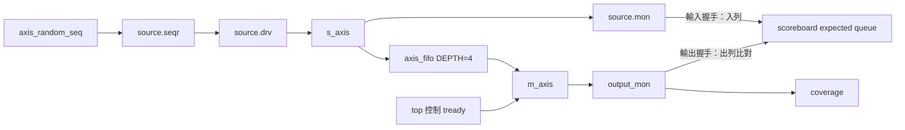

# STEP 9：AXIS FIFO 的 UVM 驗證環境

本階段完成 agent/env、隨機 payload、expected queue、FIFO DUT、排空等待、functional coverage 與傳輸途中 reset 測試。

## 先執行

```bash
make build
make run SEED=1
make reset SEED=1
make regression
```

`make regression` 跑 seed 1、7、42，各跑一般與 reset 情境，共六個 FIFO 測試，另跑四個 scoreboard self-test（正常、資料錯誤、額外輸出、遺漏輸出），log 與 coverage database 存在 `logs/`。三個反向測試必須各出現指定的一個 UVM_ERROR 才算驗證成功；一般測試仍要求零 error/fatal。

`make run`、`make reset` 會檢查 UVM report 並將失敗回傳為非零退出碼，不只依賴模擬器退出碼；每個測試有 30 秒 wall timeout，避免 solver 或模擬卡住。

需要波形時：

```bash
make run SEED=7 RUN_ARGS=+AXIS_TRACE
# 或：
make reset SEED=7 RUN_ARGS=+AXIS_TRACE
```

波形檔是 `uvm_axis.vcd`，兩次執行會覆寫同名檔案。一般與 reset 的 coverage 分別寫入 `coverage_normal.dat`、`coverage_reset.dat`。

可調整工具與 library 位置：

```bash
make build VERILATOR=/usr/local/bin/verilator UVM_HOME=/home/user/tools/uvm-2020.3.1 JOBS=2
```

本例使用 `UVM_NO_DPI`，沿用前面練習的設定。constraint randomization 需要 SMT solver；Makefile 優先使用系統 `z3`，若只有 Z3 shared library，則使用 `tools/z3_stdio.py` 呼叫真正的 Z3 evaluator。也可自行指定 `VERILATOR_SOLVER`。這個 Python 程式只是 stdin/stdout 入口，不實作求解演算法。

## 元件關係



UVM component 階層：

```text
uvm_test_top : axis_smoke_test
└── env : axis_env
    ├── source : axis_source_agent
    │   ├── seqr : uvm_sequencer #(axis_item)
    │   ├── drv : axis_driver
    │   └── mon : axis_monitor
    ├── output_mon : axis_monitor
    ├── sb : axis_scoreboard
    └── cov : axis_coverage
```

sequence 是 object，由 test 建立與啟動，不是上述 component tree 的子元件。clock、reset、介面與 DUT 都位於 `uvm_top` module。

## 檔案與責任

| 檔案 | 責任 |
| --- | --- |
| `axis_item.sv` | 一個 beat；隨機 payload，constraint 固定 `keep=1111`；`stall_cycles` 是 monitor 的觀察資訊 |
| `axis_random_seq.sv` | 送 12 個 packet、共 45 個 beat；長度 8、1、2、4 輪替，data 隨 seed 隨機 |
| `axis_source_agent.sv` | 建立 source 的 sequencer、driver、monitor，連接 driver/sequencer |
| `axis_driver.sv` | 將 item 轉成訊號，等待握手；reset 後重送尚未握手的 beat |
| `axis_monitor.sv` | 輸入／輸出共用的被動 monitor，每次握手建立新 item |
| `axis_fifo.sv` | 深度 4 的同步 FIFO，保存 data、keep、last，支援同拍入列／出列 |
| `axis_scoreboard.sv` | 依實際輸入握手入列，依輸出握手比對；reset 清空佇列 |
| `axis_coverage.sv` | 統計輸出端每個 beat 的 stall 長度、每個 packet 的 beat 數 |
| `axis_env.sv` | 組裝 source agent、輸出 monitor、scoreboard、coverage，連接 analysis ports |
| `uvm_smoke.sv` | package/include 順序、test、top、sink backpressure、reset 情境 |

`axis_basic_seq.sv` 與 `axis_checker.sv` 保留作為前面固定資料練習的參考；STEP 9 預設改用 random sequence 與 scoreboard，舊 checker 不再實例化。`tb.sv` 仍是獨立的一般 SV 範例。

## 一筆資料如何被驗證

1. Sequence 建立 item，呼叫 `randomize()` 並檢查成功；`last` 依 packet 邊界設定。
2. Driver 經由 `env.source.seqr` 取得 item，驅動 `s_axis`。
3. 只有輸入上升緣握手成功，input monitor 才將資料送到 scoreboard 的 `input_export`。
4. Scoreboard 複製這個 item，加入 expected queue。
5. FIFO 輸出上升緣握手成功時，output monitor 將資料送到 `output_export`。
6. Scoreboard 取出最早的 expected item，比對 data、keep、last；輸出沒有對應輸入、內容不同或結束時有殘留都會報錯。

比對不包含 `stall_cycles`，因為輸入／輸出的等待時間本來就可能不同。預期值由輸入握手建立，sequence 的資料只有被 DUT 接受後才進入 expected queue。

## Sequence 結束與 DUT 排空

test 先 raise objection，再執行：

```systemverilog
seq.start(env.source.seqr);
env.sb.wait_for_drain();
repeat (3) @(negedge input_vif.aclk);
```

sequence 返回時，driver 已送完輸入；FIFO 裡仍可能有資料。`wait_for_drain()` 最多等 1000 個 clock，直到 expected queue 清空，再多觀察三拍以偵測額外輸出，最後 drop objection。top 另有 100 us timeout。

## Reset 的約定

`make reset` 使用 `+AXIS_RESET`，不是任意時間的隨機 reset，而是刻意製造這個情境：

1. sink 暫停接收，FIFO 裝滿四個 beat。
2. 在 clock 上升緣確認 source 已提出下一個 beat，但因 ready=0 尚未握手。
3. 在下降緣拉低 reset，維持三個 clock，再解除。
4. FIFO 清空四筆尚未輸出的 beat；scoreboard 同步清空四筆 expected。
5. driver 重送尚未握手的 beat，繼續原本 sequence。

已輸入但被 reset 清掉的 beat **不要求重送**。這是以 beat 為單位的 FIFO，不保證 packet 原子性；reset 可能截斷一個 packet。解除 reset 後，剩餘 beat 到下一個 `last` 可形成較短的 packet。coverage 的 packet 累計會在 reset 時清零。

正常情境預期 `accepted=45 compared=45 flushed=0 pending=0`；reset 情境預期 `accepted=45 compared=41 flushed=4 pending=0 resets=1`。內容比對是否通過仍以 UVM report 的 error/fatal 為準。

## Coverage 在量測什麼

coverage 訂閱輸出 monitor，兩個 covergroup 都要求所有 bins 命中：

| Coverpoint | bins |
| --- | --- |
| 每個輸出 beat 在握手前停滯的上升緣數 | 0、1、2–3、4 以上 |
| 以 `last` 結束的輸出 packet 長度 | 1、2、3–4、5–8 |

sink 的 stall 排程是 0、1、3、6 個 clock 輪替，每次開放兩個 clock。這讓每次測試都有可預期的時序覆蓋；data 隨 seed 變化。100% 是這些已定義 bins 的覆蓋率，不代表所有 AXIS 行為都已驗證。

## 建議閱讀順序

1. `uvm_smoke.sv`：先找到 test 只剩 env 與 sequence 的位置。
2. `axis_source_agent.sv`、`axis_env.sv`：看元件如何建立與 connect。
3. `axis_scoreboard.sv`：對照 `write_input`、`write_output` 與 expected queue。
4. `axis_fifo.sv`：看滿／空、同拍讀寫與 reset。
5. `axis_coverage.sv`：看 monitor 額外記錄的 stall 資訊如何被取樣。

## 本次驗證結果

- seed 1、7、42 的一般與 reset 情境共六個測試全部通過；每次都是 0 UVM_ERROR、0 UVM_FATAL。
- 三個 seed 的 45-beat payload stream 確實不同。
- 一般情境：45 筆輸入、45 筆輸出，pending=0。
- reset 情境：45 筆輸入、41 筆輸出、4 筆因 reset 清除，pending=0。
- 每次測試的 stall 與 packet length coverpoint 都達到 100%。
- reset 波形確認：130 ns 在 FIFO 滿且 source 等待握手時拉低 reset；輸入觀察到 9 個 stalled 上升緣、輸出 58 個，stall 期間 valid 與 payload 保持穩定。driver 在 reset 時清除 valid，解除後重送同一筆未握手資料。
- scoreboard self-test 驗證三種錯誤都能被抓到；單次 `make run` 遇到真實 UVM mismatch 也會回傳失敗。

這裡的 reset 是已定義的一個受控情境。任意時間的多次 reset、部分 `keep`、多 source 與完整 AXIS 規格覆蓋可留作下一輪練習。
